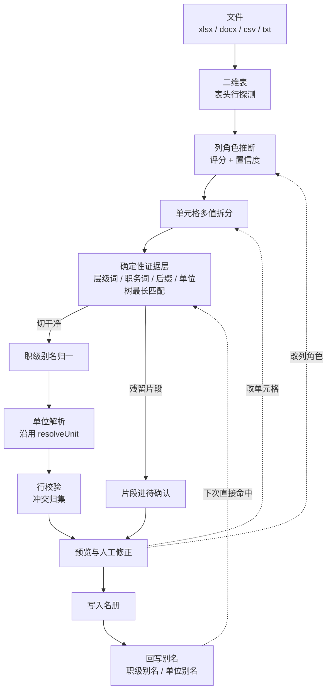

# 导入名单自适应方案（评审稿）

> 目标：让导入流程主动适配各种不规范表格，而不是要求用户先整理表格。
> 状态：**仅方案，未写实现**。已拍板项见 §15，余下两项待定。
> 影响入口：名册页「导入名单」与排座项目页「导入名单」共用 `ImportDialog`，一处改造两处生效。
> 本版要点：无分隔符连写作为拆格主场景，逐字符 DP + 回拼校验（§5）；「人员文本的规律」落成可执行的确定性证据；未知职级改为人工分配（§6.4）；新增别名回写（§11）。全程离线，不接任何外部接口。

---

## 1. 目标与非目标

**要做**

- 没有标准表头也能定位姓名、单位、职级、职务；
- 一格混写「单位 + 职级 + 职务」也能按确定性规律拆开（§5）；
- 「正科 / 正科级 / 科级正职」归一到项目已有职级；
- 认不出的职级**不新建**，交用户手动分配；
- 单位继续沿用现有解析口径，不另起一套；
- 识别结果全部可见、可改，**绝不静默丢数据**；
- 用户显式确认过的映射回写为本地别名，下次同文本走纯规则；

**不做**

- 不因“看起来像”就自动改数据：低置信只给建议，不落库；
- 不自动新建职级或单位；
- 不做跨名册的全局职级词典（职级是名册私有的）；
- 不放宽单位名称全树唯一的约束；
- 全程离线：不联网、不接任何外部接口或模型服务。

---

## 2. 现状与差距

| 能力 | 现状 | 差距 |
| --- | --- | --- |
| 表头 | 只看第一行，靠表头词判断 | 标题行、合并表头、无表头时会错位 |
| 列角色 | 表头正则 + 仅对姓名做内容兜底 | 单位/职级/职务没有内容特征判断，没有置信度 |
| 单元格 | 只对姓名列解析括号/后缀 | 单位、职级、职务混写时不拆；完全无分隔符的连写串基本无解 |
| 职级 | 名称完全一致即命中，否则统一新建 | 没有别名；也缺「认不出就不导入、交人工分配」的出口 |
| 单位 | 已按路径→短名→新建解析，名称唯一 | 可直接复用；只需接住“拆分出来的多个单位” |
| 冲突 | 文件内重名只标行；与名册已有人员重名时导入后跳过 | 跳过发生在写入后，未在提交前集中决策 |
| 复用 | 无 | 每次都要重新选列 |

---

## 3. 处理流程



每一步都产出可展示的中间结果，预览与实际导入共用同一份解析结果，避免“预览一套、入库另一套”。

---

## 4. 表头识别与列角色推断

### 4.1 找表头行

- 在前 8 个非空行中逐行打分：命中表头词（姓名/单位/职级/职务/备注/序号等）数量、短文本比例、是否含明显人名；
- 取最高分且过阈值的行作为表头；其余行按数据行处理；
- 找不到表头就不猜表头：全部按数据行解析，在界面上明确提示「未发现表头，已按内容推断」。

### 4.2 推断列角色

对每列与每个角色计算证据分：

| 角色 | 证据 |
| --- | --- |
| 姓名 | 姓氏表命中、2–6 字中文、无数字符号；同列重复率低；括号里带单位也能识别人名 |
| 单位 | 命中现有单位树（全路径/短名）为强证据；单位后缀词（局/处/科/室/中心…）；跨行重复率高 |
| 职级 | 命中现有职级或别名（强）；职级后缀词；取值集合小且顺序与职级序列一致 |
| 职务 | 职务后缀词（书记/主任/委员/长…）；取值集合比职级大；常与姓名同格出现 |
| 备注 | 电话正则、长文本、以上都不像 |

一列只保留一个主角色，按分数从高到低贪心分配，姓名列必须唯一。列的“拆分来源”不另设角色：任何列解析出的片段都可以落到其它字段。

### 4.3 置信度与低置信处理

- 高：得分 ≥ 0.75 且领先第二名 ≥ 0.2；
- 中：得分 ≥ 0.5；
- 低：其余情况。

| 置信度 | 界面 | 行为 |
| --- | --- | --- |
| 高 | 「已识别」 | 默认采用 |
| 中 | 「推测」 | 默认采用，但标黄，导入前汇总数量 |
| 低 | 「待确认」 | 不自动决定；该列留空，请用户选择 |

姓名列完全找不到时，不再默认拿第 1 列硬顶；标记为「待确认」并阻止导入，直到用户指定。

没被任何角色占用的列不删除：保留在列条上，默认「忽略」，若整列有内容则提示「该列 N 个非空值不会导入」，可一键设为备注。

---

## 5. 单元格内多值拆分

### 5.1 主场景：完全无分隔符的连续串

现实里最普遍的是整串没有任何分隔符，例如 `市财政局办公室主任`、`省厅人事处主任科员`、`市发改委重点办主任`。**无分隔符连写是拆格的主场景，不是例外**；带分隔符只是同一条算法的另一种输入。

主干固定为「逐字符推进的词典最长匹配 + 动态规划」：以已知单位树（全路径与短名两套索引）、机构层级词、职务词、职级名/别名共同确定边界。分隔符只作可选边界线索（§5.2），不作为切分依据。

先把能确定的切干净，剩下的残片交给模糊手段，仍解不出的进待确认。

#### 5.1.1 机构层级词与层级顺序

| 层级（高→低） | 常见词 |
| --- | --- |
| L1 | 部、委、办、总局 |
| L2 | 厅、局、分局 |
| L3 | 处、办公室、室、中心、站、所、队、院、校 |
| L4 | 科、股、组 |
| L5 | 公司、集团、车间、项目部、街道、镇、乡 |

判定规则：

- 同一串里从左到右，层级只能持平或下降（`局 → 处 → 科` 合法）；
- 出现层级上升（如 `科…局`）说明前面的层级词不是机构层级，整串回退为「待确认」，不硬切；
- `办公室`、`委员会`、`管委会` 算机构后缀但不占固定层级，按其在文本中的位置参与最长匹配。

#### 5.1.2 职务词

| 类别 | 词 |
| --- | --- |
| 正职 | 局长、处长、科长、股长、部长、厅长、主任、所长、站长、队长、组长、书记、主席、秘书长、理事长、经理、总监、董事长 |
| 副职 | 上表统一加「副」生成（副局长、副主任…），不逐条枚举 |
| 职级化职务 | 主任科员、副主任科员、调研员、巡视员、科员、干事、专员、办事员 |
| 泛称 | 领导、负责人、班子成员、干部 |

- 泛称只作职务候选，不参与姓名判断；
- 「主任科员」这类整词优先，不能被「主任」切开；
- 若名册里恰好定义了同名职级，优先归职级，否则按职务导入（不因为像职级就硬塞职级）。

#### 5.1.3 后缀判定

- 以机构后缀词结尾 → 整段仍是单位，即使中间出现「局/处/科」也不切出职务；
- 以职务词结尾 → 结尾部分是职务，前面剩下的继续按单位/姓名解析；
- 两类都能结尾时取最长匹配；
- 括号内容先摘出，不参与后缀判断。

#### 5.1.4 已知单位树从长到短最长匹配

1. 把单位树展开成两套索引：全路径（`局机关/办公室`）与短名（`办公室`）；
2. 两套索引按字符长度降序排列，长的先试；
3. 在待解析文本上从左到右扫描，每步取能命中的最长片段；
4. 命中后对剩余文本继续匹配，拼成单位路径；
5. 每命中一级做 5.1.1 的层级顺序校验；
6. 命中即高置信，证据写「单位树：局机关/办公室」；
7. 全部未命中才进词表切分，剩余片段进「待确认」。

#### 5.1.5 逐字符推进 + 动态规划

把原文（去掉首尾空白、摘出括号后）看作字符序列 `0…n`，`dp[i]` 表示前 `i` 个字符的最优切分得分，`dp[0] = 0`。对每个结束位置 `i`，枚举所有在此处结束的已知词 `w`（长度 `L`）：

```text
dp[i] = max( dp[i−L] + score(w) )
```

`score(w)` 由四部分构成：

| 因素 | 取值 |
| --- | --- |
| 词类型 | 单位树全路径 1.0 / 单位短名或别名 0.95 / 职级名或别名 0.9 / 职务词 0.8 / 机构层级词 0.6 / 姓氏 0.4 / 未登录片段 −0.5 |
| 后缀一致性 | 片段在串尾且以机构后缀结尾 +0.2；以职务词结尾且前面是单位 +0.1 |
| 层级顺序 | 单位片段内部层级合法 +0.1，出现上升 −0.5 |
| 分隔符 | 该边界有分隔符 +0.05（仅线索） |

约束（不满足的候选直接淘汰）：

- 姓名片段最多一个；
- 单位、职级、职务各最多一个值，出现第二个不同值即「多解」；
- 单位片段必须连续，不能跨过职务词再回到单位；
- 不得切断已知词（`主任科员`、`调研员` 等整词内部不能有边界）。

回溯前驱得到完整切分。若 `dp[n]` 不可达（有字符无法被任何词覆盖），不硬切，整段进「未归类」。

#### 5.1.6 多解与歧义怎么择优

- 保留得分最高的 3 条候选切分；
- 最优领先次优 ≥ 0.15：采用并标「推测」，证据里给出分差；
- 差距 < 0.15：**不猜**，标「待确认」，把两种切法并排展示让用户点选；
- 例：`市财政局办公室主任` 的候选里「市财政局办公室 + 主任」得分最高（单位树命中 + 职务词 + 后缀一致）；把「办公室主任」整体当单位的候选因单位树未命中且层级不合法被扣分淘汰；
- 例：`市财政局办公室人事科` 可切「市财政局办公室/人事科」（层级 室→科 合法）或两个并列单位，优先取单一单位路径；仍不确定就待确认。

#### 5.1.7 切分结果必须能拼回原串

- **硬约束**：所有片段按原顺序拼接（含未归类片段与括号内容），必须与原始单元格逐字符相等，只允许去掉首尾空白；
- 不允许凭空插入字符、丢字符或改写字符（如把全角括号换成半角）；
- 详情抽屉展示「原文 → 片段 1 ｜ 片段 2 ｜ 片段 3」的重组条，任一字符没落位即标红；
- 拼不回的切分视为解析失败，整行进「待确认」，不得静默导入；
- 实现上就是一次断言：DP 回溯后立即回拼校验，失败直接降级，不进入后续单位/职级匹配。

#### 5.1.8 切分示例

| 文本 | 结果 | 依据 |
| --- | --- | --- |
| `市财政局办公室` | 单位=市财政局办公室 | 以机构后缀结尾，整串是单位，不切 |
| `市财政局办公室主任` | 单位=市财政局办公室；职务=主任 | 无分隔符：后缀判定 + DP 择优 |
| `市财政局办公室主任科员` | 单位=市财政局办公室；职务=主任科员 | 无分隔符：整词最长匹配，不切出「主任」+「科员」 |
| `省厅人事处副调研员` | 单位=省厅/人事处；职务=副调研员 | 无分隔符：职级化职务整词优先 |
| `市财政局预算科正科级科长` | 单位=市财政局/预算科；职级=正科级；职务=科长 | 无分隔符：职级别名参与匹配；层级 局→科 合法 |
| `人事科科长` | 单位=人事科；职务=科长 | 无分隔符：短名命中单位树 |
| `市发改委重点办主任` | 单位=市发改委/重点办；职务=主任 | 无分隔符：简称按短名/别名匹配 |
| `市财政局（办公室）主任` | 单位=市财政局办公室；职务=主任 | 无分隔符：括号先摘出，内容回填单位 |
| `县教育局 人事科 科长` | 单位=县教育局/人事科；职务=科长 | 空格只是可选边界，算法同构 |
| `财政局/人事科` | 单位=财政局/人事科 | `/` 是路径，不拆 |
| `市局办公室王主任` | 单位=市局办公室；职务=主任；姓名=王（待确认） | 单字姓 + 职务只作候选，姓名需补全 |
| `办公室、人事科` | 两个单位 → 多解 | 顿号两侧都是单位，必须人工选 |

### 5.2 分隔符只作可选线索

分隔符不决定切分，只做两件事：给边界加一点分、在超长文本上先分块降低计算量。

| 符号 | 作用 |
| --- | --- |
| 换行、Tab、`;` `；`、竖线 | 先分块；块内仍走同一套 DP |
| `，` `,`、`、` | 两侧都能独立成词才作边界，否则忽略 |
| 空格 | 同上，仅作可选边界 |
| `/ \ >`、`- —` | 不作切分点，交给单位路径与层级解析 |
| 括号 | 先摘出为补充说明，再对剩余串切分 |

- 去掉分隔符后算法完全同构，不存在「有分隔符走一套、没有走另一套」；
- 分隔符只给 +0.05 的微小加分，不能压过词典命中与后缀一致性；
- DP 无任何词命中时，整段进「未归类」，**不按字符硬切**。

### 5.3 片段归类

- 命中职级/单位/职务词典 → 对应字段；
- 无法归类但带单位后缀 → 单位候选；
- 其余 → 备注 / 未归类，**不丢弃**；
- 同字段出现多个不同值（如两个单位）→ 标为「多解」，必须人工选；若其中一个精确命中单位树/职级表，可自动优先，但需在证据里注明。

示例：

| 原单元格 | 结果 |
| --- | --- |
| `办公室 正科级 主任` | 单位=办公室，职级=正科级，职务=主任 |
| `张三（办公室/正科级）` | 姓名=张三，单位=办公室，职级=正科级 |
| `局机关 / 办公室` | 单位=局机关 / 办公室（路径，不拆） |
| `办公室、人事科` | 两个单位 → 多解，需选择 |

---

## 6. 职级别名归一

### 6.1 匹配顺序（确定优先，模糊只提示）

1. 职级名完全一致；
2. 该职级维护的别名完全一致；
3. 规则生成的变体完全一致（见下表）；
4. 唯一包含关系（`正科` ⊂ `正科级`）；
5. 编辑距离 ≤ 1 的相似项：只作为候选建议，**不自动套用**。

### 6.2 规则生成

| 输入 | 归一 | 依据 |
| --- | --- | --- |
| 正科 / 副处 | 正科级 / 副处级 | 补「级」 |
| 科级正职 / 处级副职 | 正科级 / 副处级 | 方向 + 层级重排 |
| 正科级领导职务 | 正科级 | 去职务后缀 |
| 县处级正职 | 正处级 | 层级同义词（县处级→处级） |
| 乡科级副职 | 副科级 | 层级同义词（乡科级→科级） |

层级同义词表：乡科级→科级、县处级→处级、地厅级→厅级、省部级→部级。

### 6.3 映射表从哪来、谁来维护

- **内置规则**：代码里的后缀/方向/同义词规则，随版本升级；
- **名册别名（已拍板）**：`RankDef` 增加可选的 `aliases: string[]`，在「职级管理」编辑弹框里维护，随名册与备份一起走；
- **本次决策**：用户在预览里显式确认的映射回写为别名，下次直接命中（§11）；
- 同名别名指向两个职级时判为冲突，要求人工处理，不猜。

### 6.4 未知职级

**不新建。** 规则、别名都判不出时：

- 该行职级留空，行状态置「待确认」；
- 预览只给两个动作：映射到已有职级 / 由用户显式新建职级（填名称与位置）；
- 未处理的行不进入导入，「待确认」行在导入按钮层面置灰拦截；
- 用户确认的映射按 §11 回写别名，下次同一写法直接命中。

> 取舍：牺牲「一键全自动」，换取不会凭空造出一个级别。职级造错会连带影响排座规则，代价高于停下来选一次。

---

## 7. 单位匹配

完全沿用现有口径（`resolveUnit` / `planUnitInputs`）：

1. 按路径逐级匹配（根 → 叶）；
2. 路径不成立时按最后一段短名 + 单位别名（`UnitNode.aliases`）全局匹配（名称全树唯一，命中即确定）；
3. 都没命中则在路径最深前缀或指定归入单位下新建；
4. 历史重名数据判 conflict，交人工处理。

本方案只新增三点：

- 单位别名（`UnitNode.aliases`）参与短名匹配，来源见 §11；
- 拆分出的多个单位先判「多解」，不取第一个；
- 未命中时展示相近单位建议，但必须点击确认，不做模糊自动匹配（错挂单位比新建更难发现）。

---

## 8. 冲突与兜底

### 8.1 行状态

| 状态 | 触发 | 默认 |
| --- | --- | --- |
| 正常 | 全字段确定 | 可导入 |
| 推测 | 存在中置信字段 | 可导入，标黄汇总 |
| 待确认 | 低置信、多解、未知职级未决策 | 阻止该行 |
| 缺姓名 | 姓名列为空 | 默认忽略，可手填 |
| 重名 | 同名 + 同单位 | 默认跳过，可选保留/合并 |
| 已忽略 | 用户手动忽略 | 不导入 |

### 8.2 不静默丢数据

- 恒等式：`原始非空片段 = 已归字段 + 备注 + 未归类`，界面上可逐行核对；
- 被忽略的行、被跳过的重名、未归类的文本，在提交前和导入结果里都列出；
- 「待确认」行必须显式选择处理方式，不能默认吞掉（可选动作见 §15 待拍板 1）。

### 8.3 重名决策前移

同名同单位的判断从“导入后跳过”前移到预览：列出重复名单，选择 **跳过 / 保留 / 合并（补齐空缺字段）**，再一次性提交。导入结果仍保留清单。

---

## 9. 预览与修正

从上到下四块：

1. **文件摘要**：工作表名、表头所在行、有效数据行数；
2. **列角色条**：每列一个胶囊，显示角色与置信度，可下拉改；
3. **预览表**：行状态 + 拆分胶囊；
4. **详情抽屉**：选中行后展示原始单元格、拆分证据（规则 / 单位树 / 别名）与逐字段修改。

- **列角色**：下拉改角色，立即重算预览；改过的行不覆盖；
- **单元格**：展示拆分胶囊（单位·办公室 × 职级·正科级），点胶囊可改归属或改成备注；
- **逐行编辑**：姓名、单位、职级、职务可直接改；手动改过的行标「已手动修改」，重算时保留；
- **批量修正**：全部未匹配职级映射到某项、全部未知单位归入某单位、只看待确认行；
- **保存模板**：保存表头指纹、列角色、拆分覆盖、职级别名决策、归入单位；下次同结构文件自动推荐，只预览套用，不自动导入。

模板存储建议：新增本地 `import_profiles` 表，随全量备份导入导出；按名册可选绑定，跨名册只复用列映射。

---

## 10. 「系统猜的」和「没把握的」怎么区分

只用现有 token，不新增颜色与字号：

| 级别 | 文案 | 视觉 | 用户动作 |
| --- | --- | --- | --- |
| 高 | 已识别 | 次要文字色，无底色 | 不需要 |
| 中 | 推测 | `--warning` 文字 + 细描边胶囊；列头下划虚线 | 可不管，导入前汇总 |
| 低 | 待确认 | `--danger` 文字 + 胶囊；行状态同步 | 必须处理 |

- 顶部汇总条：`12 列已识别 · 2 列推测 · 1 列待确认 · 3 行需处理`；
- 「推测」是系统已填但可能错；「待确认」是系统不填、等你决定——两者文案和颜色都不同，不靠同一套黄点混用；
- 详情抽屉展示证据（如“命中单位树：局机关/办公室”“由规则 正科→正科级 生成”“别名命中：正科级”），让用户能判断而不是盲信。

---

## 11. 别名回写：确认一次，下次直接命中

- **触发**：用户在职级或单位上做过一次显式映射（把某个写法指到某个已有职级/单位），该映射记成别名；
- **写入**：`RankDef.aliases` / `UnitNode.aliases`，随名册保存、随备份导出；
- **效果**：下次同样的文本在 §5 / §6 就被别名直接命中，走纯规则，不再需要人工确认；
- **范围**：只回写指向「已有实体」的映射；新建职级/单位必须用户显式操作；
- **冲突**：一个别名指向两个实体时不写入，提示先解决冲突；
- **可见可删**：名册页展示「已学习别名 N 条」，可逐条查看、删除，删除后回到未识别状态。

别名是纯本地积累：映射过一次就沉淀在名册里，同类文本越用越准，不依赖任何外部服务。

---

## 12. 数据结构草案

```ts
type FieldKey = 'name' | 'unit' | 'rank' | 'duty' | 'note'
type Level = 'high' | 'mid' | 'low'

interface CellPart {
  field: FieldKey | 'unresolved'
  text: string
  evidence: string      // 单位树 / 层级词 / 后缀 / 分隔符 / 规则名 / 别名
  origin: 'rule' | 'unit-tree' | 'alias' | 'user'
  confidence: Level
}

interface ParsedRow {
  line: number
  fields: Record<FieldKey, string>
  parts: CellPart[]
  unresolved: string[]
  status: 'ok' | 'guess' | 'review' | 'missing-name' | 'duplicate' | 'ignored'
}

interface ColumnInference {
  index: number
  role: FieldKey | 'ignore'
  confidence: Level
  score: number
  extras: FieldKey[]    // 该列还能拆出的字段
}

interface ImportProfile {
  id: string
  name: string
  rosterId?: string
  headerSignature: string[]
  roles: Record<number, FieldKey | 'ignore'>
  aliasChoices: Record<string, string>
  fallbackUnitId?: string
}

// 职级 / 单位增加可选别名，旧数据不受影响
interface RankDef {
  // ...原有字段
  aliases?: string[]
}
interface UnitNode {
  // ...原有字段
  aliases?: string[]
}

interface AliasRecord {
  text: string          // 原始写法
  targetId: string      // 职级 / 单位 id
  createdAt: string
}
```

---

## 13. 分阶段落地

| 阶段 | 内容 | 验收 |
| --- | --- | --- |
| P0 | 表头行探测、列角色评分与置信度、确定性证据层（层级词 / 职务词 / 后缀 / 单位树最长匹配）、无分隔符连写的逐字符 DP + 回拼校验、行状态与未归类清单、预览三档标识 | 验收样例全部通过且无静默丢数据 |
| P1 | 职级别名规则、`RankDef.aliases` / `UnitNode.aliases`、未知职级人工分配、别名回写 | 「正科/科级正职/县处级正职」正确归一；未知职级一律不新增 |
| P2 | 导入模板、批量修正、模板自动推荐 | 同结构文件第二次导入零改列 |

### 13.1 验收样例

| 输入 | 期望 |
| --- | --- |
| 无表头，姓名在第 3 列 | 姓名列被内容特征选中并标注置信度，不再默认第 1 列 |
| 单元格「办公室 正科级 主任」 | 单位 / 职级 / 职务三字段拆开，行状态正常 |
| `市财政局办公室主任` | 单位=市财政局办公室，职务=主任（后缀判定） |
| `省厅人事处主任科员` | 单位=省厅/人事处，职务=主任科员，职级留空不新建 |
| `市财政局办公室主任科员`（全连写） | 整词优先，切出单位 + 主任科员，不多切一个「科员」 |
| `市财政局预算科正科级科长`（全连写） | 单位 / 职级 / 职务三字段，无任何分隔符 |
| `人事科科长`（短名连写） | 短名命中单位树 |
| `市财政局（办公室）主任` | 括号先摘出再切分 |
| 任一连写串 | 片段可逐字符拼回原文，拼不回即阻断该行 |
| 职级「正科」「科级正职」「县处级正职」 | 分别归一到正科级、正科级、正处级，证据可见 |
| 单位「局机关 / 办公室」与「办公室」 | 路径与短名命中同一单位 |
| 同名同单位 + 未知职级 | 提交前列出重名；未知职级不新建，该行停在待确认 |
| 同一写法人工映射过一次后再次导入 | 第二次别名直接命中，无需人工确认 |
| 无法归类的长文本 | 进入「未归类」，不阻断其它行，但提交前必须可见 |

---

## 14. 核心取舍

1. **建议而非代决**：低置信不落库，牺牲一点“全自动”，换来错误不会被静默固化。
2. **确定性证据优先，分隔符不作依据**：无分隔符连写是主场景，靠单位树、层级词、职务词做逐字符 DP 定边界；分隔符只加分，不决定切分。
3. **别名确定匹配，模糊只提示**：职级别名可确定；编辑距离相似只给候选，防止“差不多”映射到错级别。
4. **单位不做模糊自动匹配**：错挂单位的代价高于新建，相近名称只做建议。
5. **未知职级不新建（已拍板）**：宁可停下来让用户选，也不凭空造级别；造错会污染排座规则。
6. **全程离线**：不接任何外部接口，宁可把长尾写法留给人工，也不引入网络依赖与数据外发风险。
7. **回写别名让系统自我收敛**：确认一次，之后永久本地命中，人工介入量随使用递减。
8. **模板与别名都存本地并随备份**：不搞全局共享词典，避免跨名册污染。

---

## 15. 决策记录

**已拍板**

| # | 决策 |
| --- | --- |
| 1 | 认不出的职级**不新建**，改为提示用户手动分配。 |
| 2 | 职级别名放在职级定义里（`RankDef.aliases`），随名册与备份一起走。 |
| 3 | 全程离线，不接入模型或任何外部接口；长尾写法交人工确认。 |
| 4 | 用户显式确认的映射回写为本地别名（职级别名、单位别名），下次走纯规则。 |

**待拍板**

1. 「待确认」行是否允许一键「按当前解析全部导入」，还是必须逐行处理或显式跳过？
2. 导入模板是否本轮就持久化（新增本地表并纳入备份），还是先只做本次会话？
